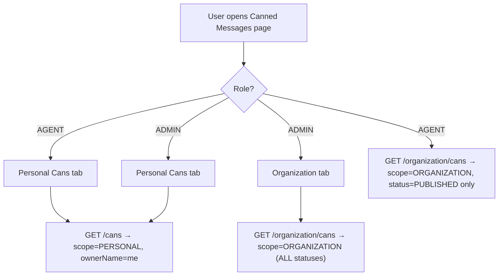

# Supabase Database Guide — Healthyday Canned Messages

> How to view and understand all data in your Supabase project, from canned messages to users.

---

## Database Overview

The app uses **3 tables** in Supabase:

| Table | Purpose |
|---|---|
| `cans` | All canned messages (personal + organization) |
| `notifications` | Publish/update events broadcast to all agents |
| *(users via headers)* | No `users` table — identity is passed via HTTP headers (`x-user-name`, `x-user-role`) |

> [!NOTE]
> There is **no separate users table**. Each user's identity (`name` + `role`) is stored in the browser extension's local storage and sent as HTTP headers on every request. The backend reads these headers to identify who is making the request.

---

## Table 1 — `cans`

This is the main table. Every canned message — whether Personal or Organization — lives here, differentiated by the `scope` column.

### Schema

| Column | Type | Description |
|---|---|---|
| `id` | `uuid` | Primary key, auto-generated |
| `title` | `text` | Display name of the message (e.g. "Interview Intro") |
| `shortcut` | `text` | Trigger keyword (e.g. `/intro`) |
| `content` | `text` | Full message body |
| `scope` | `text` | `'PERSONAL'` or `'ORGANIZATION'` |
| `status` | `text` | `'PUBLISHED'` or `'DRAFT'` (only relevant for ORGANIZATION scope) |
| `ownerName` | `text` | The `x-user-name` of the user who created it |
| `created_at` | `timestamptz` | Auto-set on insert |
| `updated_at` | `timestamptz` | Auto-updated on edit (if trigger is configured) |

### How to view in Supabase

1. Go to [supabase.com](https://supabase.com) → your project
2. Click **Table Editor** in the left sidebar
3. Select the **`cans`** table

---

### SQL Queries — `cans`

#### View ALL cans (Admin overview)
```sql
SELECT * FROM cans ORDER BY created_at DESC;
```

#### View only Personal cans for a specific agent
```sql
SELECT id, title, shortcut, content, "ownerName", created_at
FROM cans
WHERE scope = 'PERSONAL'
  AND "ownerName" = 'Hemanth'   -- replace with agent's name
ORDER BY created_at DESC;
```

#### View all Personal cans (all agents)
```sql
SELECT id, title, shortcut, content, "ownerName", created_at
FROM cans
WHERE scope = 'PERSONAL'
ORDER BY "ownerName", created_at DESC;
```

#### View Organization cans — what Admins see (all statuses)
```sql
SELECT id, title, shortcut, content, status, "ownerName", created_at
FROM cans
WHERE scope = 'ORGANIZATION'
ORDER BY created_at DESC;
```

#### View Organization cans — what Agents see (published only)
```sql
SELECT id, title, shortcut, content, "ownerName", created_at
FROM cans
WHERE scope = 'ORGANIZATION'
  AND status = 'PUBLISHED'
ORDER BY created_at DESC;
```

#### Count cans per agent
```sql
SELECT "ownerName", COUNT(*) AS total_cans
FROM cans
WHERE scope = 'PERSONAL'
GROUP BY "ownerName"
ORDER BY total_cans DESC;
```

#### Find cans by shortcut (useful for debugging conflicts)
```sql
SELECT * FROM cans WHERE shortcut = '/intro';
```

---

## Table 2 — `notifications`

Created automatically by the backend whenever an Admin **publishes** or **updates** an Organization can. All agents receive these.

### Schema

| Column | Type | Description |
|---|---|---|
| `id` | `uuid` | Primary key |
| `type` | `text` | `'CAN_PUBLISHED'` or `'CAN_UPDATED'` |
| `message` | `text` | Human-readable description (e.g. `New organization can published: "Interview Intro"`) |
| `canId` | `uuid` | FK → `cans.id` — which can triggered this notification |
| `readBy` | `text[]` | Array of `ownerName` values who have marked it read |
| `created_at` | `timestamptz` | Auto-set on insert |

### SQL Queries — `notifications`

#### View all notifications (newest first)
```sql
SELECT * FROM notifications ORDER BY created_at DESC;
```

#### View unread notifications for a specific agent
```sql
SELECT id, type, message, "canId", created_at
FROM notifications
WHERE NOT ("readBy" @> ARRAY['Hemanth'])   -- replace with agent name
ORDER BY created_at DESC;
```

#### View which agents have read a specific notification
```sql
SELECT "readBy" FROM notifications WHERE id = '<notification-uuid>';
```

#### Count unread notifications per user (across all agents)
-- This requires knowing all agent names. Simpler: just look at readBy arrays:
```sql
SELECT id, message, "readBy" FROM notifications ORDER BY created_at DESC LIMIT 20;
```

---

## Role-Based Data Access — What Each Role Sees



| Action | Agent | Admin |
|---|---|---|
| View own personal cans | ✅ | ✅ |
| View other agents' personal cans | ❌ | ❌ (via API — use Supabase Table Editor directly) |
| View published org cans | ✅ | ✅ |
| View draft org cans | ❌ | ✅ |
| Create personal can | ✅ | ✅ |
| Create org can | ❌ | ✅ |
| Edit org can | ❌ | ✅ |
| Delete org can | ❌ | ✅ |
| Publish org can | ❌ | ✅ |

> [!IMPORTANT]
> The API enforces role checks via `requireAdmin` middleware. However, **Supabase Table Editor bypasses these checks** — you can see all rows directly there as the project owner.

---

## How to View Data by User Type in Supabase

### As Admin — see everything any agent has

Go to **SQL Editor** in Supabase and run:

```sql
-- All personal cans grouped by agent
SELECT "ownerName", scope, COUNT(*) AS count
FROM cans
GROUP BY "ownerName", scope
ORDER BY "ownerName";
```

### See a specific agent's full library

```sql
SELECT title, shortcut, LEFT(content, 80) AS preview, created_at
FROM cans
WHERE "ownerName" = 'AgentNameHere'
ORDER BY created_at DESC;
```

### See the most recently added cans (all users)

```sql
SELECT title, shortcut, scope, "ownerName", created_at
FROM cans
ORDER BY created_at DESC
LIMIT 20;
```

### Check for shortcut conflicts across the org

```sql
SELECT shortcut, COUNT(*) AS uses, array_agg("ownerName") AS owners
FROM cans
WHERE scope = 'PERSONAL'
GROUP BY shortcut
HAVING COUNT(*) > 1;
```

---

## How to Access Supabase SQL Editor

1. Open [supabase.com](https://supabase.com) → your project dashboard
2. Click **SQL Editor** in the left sidebar (looks like `</>`)
3. Click **+ New query**
4. Paste any of the queries above and click **Run** (or press `Ctrl+Enter`)

> [!TIP]
> You can also use the **Table Editor → Filter** feature to filter rows visually without SQL. Click a column header to sort. Use the search bar to filter by value.

---

## Environment Check — Is Supabase Connected?

Check your backend `.env` file:

```env
SUPABASE_URL=https://your-project-ref.supabase.co
SUPABASE_KEY=your-anon-or-service-role-key
```

When the backend starts correctly you'll see in the terminal:
```
🔗 Supabase connected → https://your-project-ref.supabase.co…
```

If you see `⚠️ SUPABASE_URL / SUPABASE_KEY not set` — add the values to `backend/.env` and restart the server.

---

## Quick Reference — API Endpoints vs Supabase Queries

| API Endpoint | Who calls it | Equivalent Supabase Query |
|---|---|---|
| `GET /cans` | Agent or Admin (own cans) | `SELECT * FROM cans WHERE scope='PERSONAL' AND "ownerName"='<name>'` |
| `GET /organization/cans` (Agent) | Agent | `SELECT * FROM cans WHERE scope='ORGANIZATION' AND status='PUBLISHED'` |
| `GET /organization/cans` (Admin) | Admin | `SELECT * FROM cans WHERE scope='ORGANIZATION'` |
| `POST /cans` | Anyone | `INSERT INTO cans (title, shortcut, content, scope, "ownerName") VALUES (...)` |
| `POST /organization/cans/:id/publish` | Admin only | `UPDATE cans SET status='PUBLISHED' WHERE id='...'` |
| `GET /notifications` | Anyone | `SELECT * FROM notifications ORDER BY created_at DESC LIMIT 50` |
